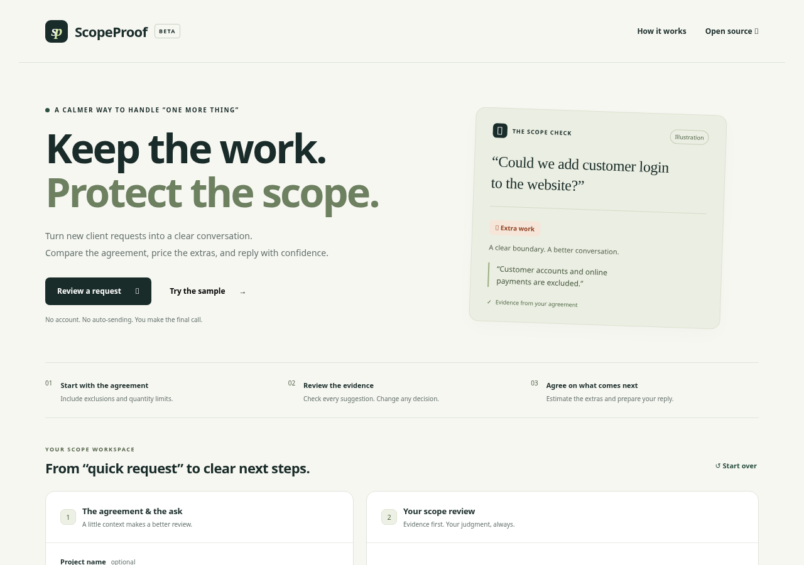

# ScopeProof

**Keep the work. Protect the scope.** A small, evidence-first freelance scope-change assistant for the [Hacktoberfest Open-Source AI Challenge: Week 2 — Side Hustle](https://dev.to/challenges/hacktoberfest-week2-2026-10-12).

ScopeProof compares an original agreement with up to eight client requests. It suggests **Included**, **Extra work**, or **Needs clarification**, checks supporting quotes verbatim, and leaves every final decision to the freelancer. User-entered hours and rates produce a proposed change quote; an editable reply and text/print report make the next conversation easier. Nothing is sent to a client automatically.

Live demo: **https://scopeproof.onrender.com** · [Published DEV submission](https://dev.to/tanzil_ahmed_e6a826eee8c4/scopeproof-an-evidence-first-answer-to-one-more-thing-3odi). See [deployment evidence](docs/evidence/deployment.json) and [manual public verification](docs/evidence/manual-public-verification.json) for how the workflow was checked.



## Quick start

Requires **Node.js 24** (tested on 24.19.0). No production dependencies, database, login, build step or external fonts.

```sh
npm ci --ignore-scripts
npm test
npm start
```

Open the address printed by the server on port 3000. The labelled illustrative sample works without credentials and makes no AI calls. Sample classifications are prewritten, not inference evidence. Sample estimates start blank.

For live analysis, copy `.env.example` to an ignored `.env`, enter your own Backboard credential securely, and set:

```dotenv
BACKBOARD_MODEL=qwen/qwen3-32b
LIVE_ANALYSIS_ENABLED=true
```

First verify the current Backboard catalogue, actual inference availability, pricing and **model-token** balance. A catalogue listing alone is insufficient: Qwen3-8B and Qwen3-14B were listed but failed at inference during this project's checks. No closed model or automatic router is used. Only allowlisted open-weight model identifiers are accepted. `BACKBOARD_API_KEY` stays on the server. Render and DEV credentials are deployment/publishing tools only and do not belong in the application.

`npm run check:access` verifies the three task credentials using read-only API calls without printing them. For app-only development you need only Backboard; Render/DEV diagnostics will correctly fail if their publishing keys are absent.

## Try the workflow

1. Load the clearly labelled sample, or enter the real agreement, exclusions and limits, then one request per line.
2. For live inference, acknowledge that input is sent to hosted AI services and select **Analyze with AI**.
3. Read each reason and supporting quote. Change any decision using its dropdown.
4. Enter your own hours for extra work, rate and currency. **Estimate incomplete** means one or more extra-work requests still have blank hours; the help text counts them. Enter `0` only when you intentionally estimate no charge. Each line rounds to the currency's minor unit before summing; tax, discounts and contractual payment terms are outside scope.
5. Edit the client reply, copy it, export a text report, or print/save PDF. The report includes your overrides and edited reply. Nothing is sent automatically.

Editing the agreement or requests invalidates the old review. Results arriving after an input change are discarded. Editing estimates preserves your custom reply and asks you to check or refresh it.

## Architecture

```text
Browser (static HTML/CSS/ES modules, no credentials)
  → POST /api/analyze (same origin, bounded JSON)
  → Node.js HTTP server (validation, quotas, concurrency, timeout)
  → Backboard POST /api/threads/messages
  → explicitly selected Qwen open-weight model via OpenRouter
  → strict structured-result validation + exact substring quote check
  → editable human decisions → deterministic quote/reply/report
```

`public/domain.mjs` shares deterministic input, evidence, quote and report logic between browser and server. `lib/backboard.mjs` contains the server-only integration and prompt. `server.mjs` serves an explicit static-file allowlist and API endpoints. `GET /healthz` checks process health; `GET /api/status` reports live configuration and remaining process attempts, never credentials. Neither endpoint proves inference availability or account balance.

Every analysis starts a new Backboard conversation. `memory` and web search are off. The application attempts to delete the temporary thread after receiving its ID; cleanup failure is logged without input or credentials. No shared conversation is reused. Default Backboard assistant objects may remain; providers can retain data under their policies. A request that fails before returning an ID cannot be cleaned up by this application.

## Validation and evidence

```sh
npm test                         # deterministic unit + mocked HTTP/provider integration
python -m pip install -r requirements-dev.txt
python -m playwright install chromium
npm start                        # another terminal
# Default browser path is /usr/bin/chromium; set CHROMIUM_PATH for your installation.
npm run test:browser              # real browser; AI/error responses are explicitly mocked
npm run test:live                 # PAID, synthetic two-model evaluation using your Backboard key
# Optional: against a configured app, one real paid browser request (no mocks):
# BASE_URL=https://scopeproof.onrender.com RUN_PAID_BROWSER_TEST=1 npm run test:browser:live
```

Browser checks use the pinned `axe-core` development dependency. Automated accessibility checks do not establish complete accessibility. Read [test evidence](docs/testing.md), [actual live runs](docs/evidence/), [architecture and safeguards](docs/architecture.md), and [submission readiness](docs/submission-checklist.md). Test counts and live model results are reported separately. The tiny evaluation is diagnostic evidence, not a general benchmark or legal-accuracy claim.

## Render deployment

`render.yaml` defines one free Node web service. The verified explicit production model is `qwen/qwen3-32b`; configure it and `LIVE_ANALYSIS_ENABLED=true` only after checking usable Backboard token credit and pricing. Set the Backboard key securely in Render's environment variables. Never add DEV/Render API keys to the service. Render's free plan can sleep and has shared account-hour/resource limits; no always-on uptime is promised. The blueprint disables automatic deployments to avoid unnecessary restarts/builds. Consult the deployment evidence before claiming this instance is public or live.

**Configure the real Backboard key directly in Render.** A cloud environment may expose a proxy-resolved credential reference; copying that reference into Render does not transfer the credential. Do not extract proxy-held secrets. Enter the actual key securely through the existing Render service's Environment settings, then save/deploy. When live configuration is enabled, startup performs a read-only Backboard billing-access check and logs only its HTTP status. HTTP 200 verifies that read operation, not model inference. HTTP 401/403 on analysis produces an authentication error; any previous sample stays explicitly labelled as sample output.

Default demo limits: 6,000 scope characters, 8 requests of 500 characters, 20 live attempts per process, 3 per socket IP per hour, and one concurrent analysis. Provider timeout is 45 seconds, followed by at most 5 seconds for thread cleanup. Failed attempts count. No automatic paid retries. Limits can be reduced with the variables in `.env.example`; hard-coded upper bounds prevent accidental large settings. Behind a reverse proxy, socket IP limits may group visitors and be more restrictive. A public production product would need persistent quotas and stronger abuse controls.

**In-memory limits reset on restart and are not guaranteed account spending caps.** Use provider-side billing controls, monitor actual usage, and disable live inference when the demo budget is exhausted. Do not assume memory-only promotional credit pays for model tokens. No top-up or paid Render plan is enabled by this project.

## Privacy and limitations

- Live input goes to **Backboard and its hosted model provider** (OpenRouter routing). This is not offline inference. Memory off and attempted thread deletion do not mean zero retention. Avoid confidential client material. See [Backboard's privacy policy](https://backboard.io/privacy-policy).
- This app does not intentionally store agreements, requests or replies on disk, in a database, analytics or browser storage. They remain in page memory while open; downloaded reports are saved by you. Hosting/provider logs and retention policies still apply.
- A matching quote verifies text, not relevance or contractual interpretation. Models can miss contradictions, exclusions, consumed revision limits and ambiguous language, and can be influenced by hostile instructions. Unsupported/invented quotes are removed and downgraded to clarification, not silently accepted.
- Prompt separation, validation, safe text rendering, a restrictive Content Security Policy and no tool execution reduce risk; they do not make prompt injection impossible. Do not treat a suggestion as legal advice, proof of approval or an invoice.
- Human overrides are recorded, not reclassified by AI. Estimated hours and money come only from user inputs. Written client approval and timeline negotiation happen outside ScopeProof.
- No paying users, revenue, customer feedback, comparative superiority or prize outcome is claimed.

## Credits and licensing

Application code: **MIT**, copyright Tanzil Ahmed (existing license retained). Implementation, testing and writing were assisted by OpenAI Codex; the owner is responsible for the published project. No external application source archive or prior implementation was supplied.

Models: [Qwen3-32B](https://huggingface.co/Qwen/Qwen3-32B), and evaluated alternatives credited in the evidence, by the Qwen team, **Apache 2.0**. Model weights are not bundled. Open weights make a different host, quantization or future local deployment possible; the current deployment still uses hosted APIs and makes no measured privacy or cost advantage claim against closed models.

Actual comparison model: [Qwen3.5-9B](https://huggingface.co/Qwen/Qwen3.5-9B), Apache 2.0. It completed the two-request adversarial fixture but timed out on the six-request fixture under the 45-second application limit; no automatic retries were made. See [comparison evidence](docs/evidence/comparison.json). Qwen3-32B is explicitly selected for the deployed demo.

Services: [Backboard](https://backboard.io), OpenRouter and [Render](https://render.com). Integration references: [Backboard messages](https://docs.backboard.io/concepts/messages), [billing](https://docs.backboard.io/concepts/billing), verified published `backboard-sdk` 1.5.19 API definitions (SDK not bundled), [Render API](https://render.com/docs/api) and [official OpenAPI](https://api-docs.render.com/openapi/render-public-api-1.json). Test tools: [Playwright](https://playwright.dev/python/) (Apache 2.0), [axe-core](https://github.com/dequelabs/axe-core) (MPL 2.0). Interface uses original CSS, system fonts and text symbols; no third-party imagery or fabricated customer material.

## Challenge history

The repository's initial commit is dated October 15, 2026, within the official October 12–18 challenge window. Commit dates are preserved. The official deadline is October 18 at 11:59 PM PDT (October 19 at 12:59 PM Asia/Dhaka). Any project commits made after that deadline must be explicitly disclosed here. No after-deadline changes are currently claimed.
